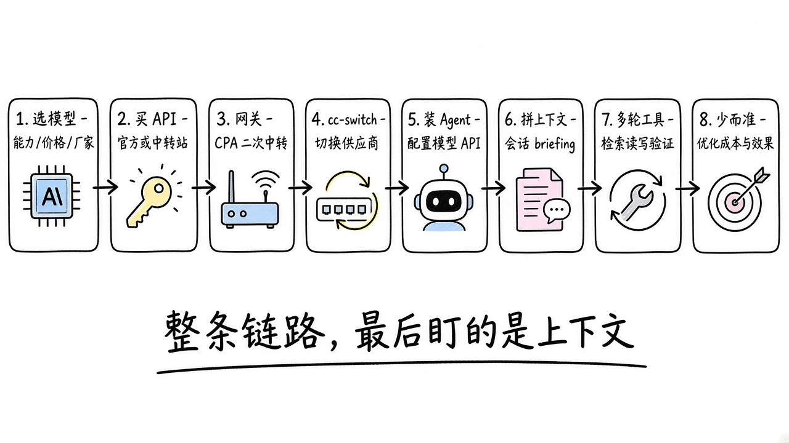
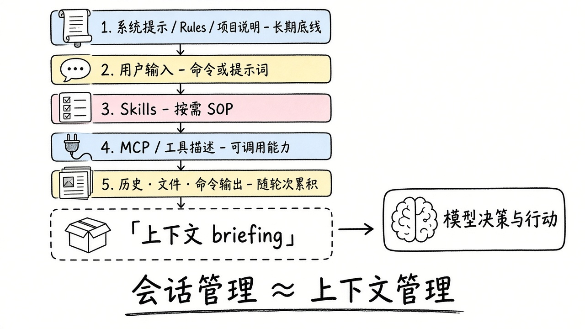
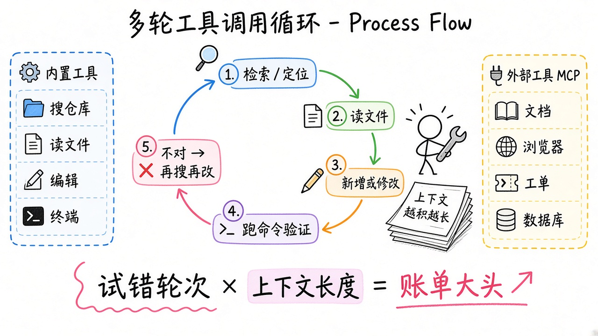
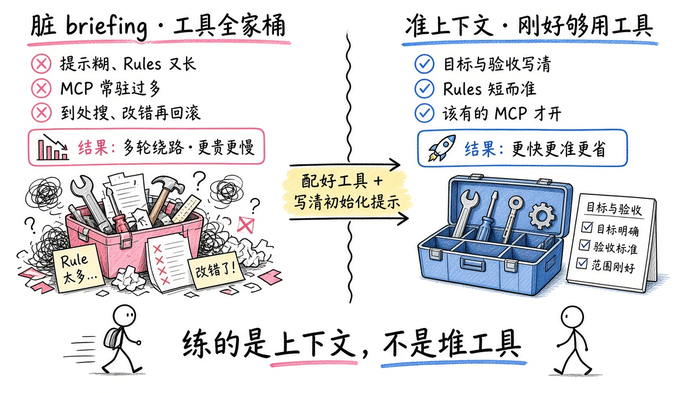

# 全流程总览


## 全流程总览：一条该先走通的线

站内按栏目拆得很细：选型、环境、Agent、实践各管一段。很多人卡在中间：模型买了、工具装了，效果时好时坏，账单还在涨。

根因多半不是「模型不够强」，而是没把整条链路当成一件事来管。链路末端每一次会话，先拼一份上下文，再进入多轮「检索 / 读写 / 调工具」；Rules、Skills、MCP 和你的提示都会进这份上下文，工具返回还会继续叠进去。

> **同一套 Agent + 同一个模型，上下文与工具配得不同，效果和账单都能差一截。**  
> 反过来：换了更贵的模型，briefing 又脏、工具又乱，多绕几圈照样不划算。

下面按顺序串完整条主线。每一步只给判断要点、具体工具入口和站内深读；细节页负责「怎么配」。



---

## 1. 选模型：能力、价格、厂家

先回答三件事，再谈买不买：

| 看什么 | 为什么 | 站内入口 |
|--------|--------|----------|
| **能力** | 编程 / 推理 / 长上下文是否够用；工具调用是否稳 | [模型评测与榜单](/programming/leaderboard.html) |
| **价格** | 别只看「多少钱 / 百万 token」；Agent 多轮要把账单与体感拆开看 | [Coding Plan 与渠道](/programming/coding-plan.html) · [省钱与 Token 治理](/programming/ai-coding-save-money.html) |
| **厂家与渠道** | 官方稳定性、区域可用性、是否接受第三方 | [Coding Plan / 渠道](/programming/coding-plan.html) |

价格与体感，落到四个量上比才有用：

| 要素 | 看什么 |
|------|--------|
| **输入** | 系统提示、Rules、读入文件、历史对话等进模型一侧；多轮体积大头常在这，单价通常低于输出 |
| **输出** | 模型回复与工具调用决策；单价常更高，推理 / thinking 档还可能另计 |
| **缓存命中率** | 长会话里重复前缀能否命中提示词缓存；命中高，输入侧账单会明显下来；还要确认写缓存是否收费、能否跨会话命中 |
| **首字速度** | 首 token 延迟（TTFT）；工具多轮每一跳都在等它，体感卡不卡主要看这 |

常见候选：Claude、GPT、Gemini、DeepSeek、Kimi、Qwen 等，先看榜单维度再定档。Agent 场景往往是「输入体积大 + 输出不短 + 轮次多」：单价、缓存规则、首字速度一起看，比单看标价靠谱。预算紧就先定月预算，再倒推能用哪档，见 [省钱与 Token 治理](/programming/ai-coding-save-money.html)。

---

## 2. 购买模型 API：官方或中转 / 聚合

模型定了，下一步是拿到可调用的 API（或等价订阅额度）：

- **官方**：合规、文档全、规则透明；门槛可能是支付、账号与区域。
- **中转 / 聚合**：降低支付与接入摩擦，但要分清倍率、额度口径与渠道风险。

链路怎么读、风险怎么判，见 [API 中转站](/programming/api-relay-station.html)；订阅型 / 按量型对照见 [Coding Plan](/programming/coding-plan.html)。

到手后通常有：**Base URL + API Key + 可用模型名**。后面所有工具都吃这三样（或兼容形态）。

---

## 3. 网关再中转一层（可选但常见）

很多人不会把「买来的 Key」直接写进每一个 Agent，中间再挂一层网关。个人场景省心，团队场景几乎刚需。常见动机是：

- **多供应商接入**：官方 + 中转 + 订阅转 API 合成一个入口；统一鉴权、轮询、故障转移、协议互转
- **订阅变 API**：把 Claude / ChatGPT / Copilot 等订阅能力转成兼容接口，给 Cursor / Claude Code / Codex 等一起用
- **团队 Token 分配**：按人 / 组发子 Key、设额度与倍率，谁用多少可回收、可限流，而不是共用一把总钥匙
- **人员用量分析**：按账号、模型、时间看 token / 缓存命中 / 花费，定位「谁在烧、哪类任务在烧」

```text
厂家 / 中转站（多供应商）  →  网关（鉴权 · 配额 · 路由 · 用量）  →  个人 / 团队 Agent
```

选型可粗分两路：

| 侧重 | 典型工具 | 适合 |
|------|----------|------|
| 本机 / 个人 | [CLIProxyAPI（CPA）](https://github.com/router-for-me/CLIProxyAPI)、[magpie](https://github.com/yetone/magpie)、[Claude Code Router](https://github.com/musistudio/claude-code-router) | 自己多 Agent、多账号故障转移、本机一处切换 |
| 团队 / 自建分发 | [New API](https://github.com/QuantumNous/new-api)、[Sub2API](https://github.com/Wei-Shaw/sub2api)、[LiteLLM](https://github.com/BerriAI/litellm) | 多渠道接入、子 Key 配额、计费与用量看板 |

环境侧总览见 [路由与本地网关](/agent-tools/routing-gateway.html)；中转站分工与倍率见 [API 中转站](/programming/api-relay-station.html)。

没有网关也能用；一旦多家供应商、多人共用额度、或多台机器 / 多种 CLI，网关会明显省心。

---

## 4. 用 magpie 切换不同 API 服务商

API 和网关配好后，日常痛点变成：Claude Code / Codex / Gemini CLI 等各自一套配置，换供应商很烦。

[magpie](https://github.com/yetone/magpie) 做可视化管理：任意 Agent 接任意模型，本机网关 + 多账号故障转移，菜单栏一处切换。适合「主力一家、备用一家、临时试新模型」。同类桌面还可看 [Cockpit Tools](https://github.com/jlcodes99/cockpit-tools)、[AI Toolbox](https://github.com/coulsontl/ai-toolbox)。

magpie 可代替此前常用的 [CC-Switch](/programming/cc-switch.html)，并支持从 CC Switch 导入配置。更多切换类工具见 [账号与供应商切换](/agent-tools/account-switch.html)。

这一步解决的是**接入面的可切换性**，还不等于效果变好。效果要看后面装了什么、每次会话塞进上下文的是什么。

---

## 5. 安装 Agent，并把模型 API 配进去

「能聊天」和「能干活」之间，差的是 Agent 工具链：读仓库、改文件、跑命令、调 MCP。

常见产品（一句话选型，细节进横评页）：

| 产品 | 一句话 | 深读 |
|------|--------|------|
| [Claude Code](https://claude.com/product/claude-code) | 整库理解、批量改文件、MCP / 子 Agent，专业向 | [Coding Agent 横评](/programming/code-cli.html) |
| [Codex](https://developers.openai.com/codex) | ChatGPT 原生登录，开箱快；额度消耗大 | [Codex 实践](/practice/codex.html) |
| [Cursor](https://cursor.com/) | IDE 内 Agent，适合边写边改 | [Cursor 实践](/practice/cursor.html) |
| [Gemini CLI](https://github.com/google-gemini/gemini-cli) / [Grok CLI](https://x.ai/news/grok-build-cli) | 终端优先、绑定各自生态 | [IDE 与编程工具](/programming/vb-code-tool.html) |
| [DeepSeek Harness](https://www.deepseek.com/harness/) | 开源 harness，一切皆插件；日常办公 + 写代码，桌面 / Web 开箱即用 | [Agent 工作区](/agent-tools/agent-workspace.html) |
| [Kiro](/practice/kiro-practice.html) / [Pi](https://github.com/earendil-works/pi) | 规格驱动上手包 / 可自扩展终端 Agent | 见右栏链接 |

每个 Agent 都要完成同一件事：**指向你的 API 入口（官方 / 中转 / CPA），选好默认模型**。环境底座见 [开发环境准备](/programming/dev-start.html)；

装完只是「油箱和车钥匙就位」。真正决定每一次任务成败的，是引擎每次点火时读到的那份上下文。

---

## 6. 每次会话，就是一次上下文管理

Agent 发起一轮请求时，并不是只把你刚打的字发出去，而是拼装一整包材料再交给模型：

```text
系统提示 / Rules / 项目说明
+ 你的输入（自然语言或 /command）
+ 按需加载的 Skills
+ MCP 工具描述与工具返回
+ 对话历史、读过的文件、命令输出…
→ 模型根据这份 briefing 决策与行动
```



所以：**会话管理 ≈ 上下文管理**。新开会话、压缩历史、换目录、开关 MCP，都是在改 briefing 的内容与体积。

按「谁写进上下文」粗分：

| 成分 | 角色 | 深读 |
|------|------|------|
| **Rules / 项目说明** | 长期底线与环境事实 | [Rules](/agent/rules.html) |
| **用户输入** | 这次要干什么 | [Commands](/agent/commands.html) · [Prompt](/agent/prompt.html) |
| **Skills** | 某类任务的 SOP | [Skills](/agent/skills.html) |
| **MCP / 工具** | 可调用能力；调用后结果回流 | [MCP](/agent/mcp.html) |
| **工具往返产物** | 检索命中、文件内容、命令输出 | 随轮次累积，常是体积大头 |

想看清「这一轮到底塞了什么」：走 [magpie](https://usemagpie.ai/zh/) 本机网关后，打开**路由**页可盯每次请求的路由决策与上下文窗口；**用量 → 上下文**里还能按系统提示、工具 / MCP、Skills、读入文件、工具输出、对话分段看各占窗口多少。

---

## 7. 干活中：多轮工具调用才是大头

Agent 很少「想一次就交卷」。接到任务后，典型是多轮循环：

```text
检索 / 定位 → 读文件 → 新增或修改 → 跑命令验证 → 不对再搜再改
```



每一跳都在调工具。粗分两类：

| 类型 | 常见能力 | 谁提供 |
|------|----------|--------|
| **内置工具** | 搜仓库、读文件、编辑、跑终端 | Agent 产品自带 |
| **外部工具** | 查文档、浏览器、工单、数据库等 | 多半经 [MCP](/agent/mcp.html) 接入 |

代码侧常配：本地混合检索用 [Zvec](https://zvec.org/zh/)，调用图 / 影响面用 [Codegraph](https://github.com/colbymchenry/codegraph)，内容搜用 [ripgrep](https://github.com/BurntSushi/ripgrep)。更多见 [记忆 · 上下文 · 检索](/agent-tools/memory-retrieval.html)。

工具一返回，内容就会叠进上下文；后面每一轮往往还带着前面读过的文件、搜过的结果、跑过的日志。账单大头经常不是你打的那几句字，而是**试错轮次 × 越积越长的上下文**（见 [省钱之道](/programming/ai-coding-save-money.html)）。

> **合适的工具 + 写清的初始化提示，往往比「少装点东西」更能省钱。**  
> 因为它们砍的是冤枉路：少瞎搜、少猜 API、少改错文件再回滚。

对应三条：

- **Rules / 项目说明**：写清入口目录、技术栈约定、禁改区域、怎么算做完
- **刚好够用的外部工具**：任务真需要查官方文档、操作某个系统，就配对应 MCP；没有它，模型只能猜或在仓库里空转
- **不该上场的关掉**：工具描述本身占上下文；误触发还会拖进一堆无关返回

---

## 8. 优化：少而准（成本与质量一起管）

粗规律三条：开场送得越多 Token 越多；干活轮次越多越贵；送得太少或太偏，返工往往比「多送一点点准材料」更贵。

目标不是「上下文越少越好」，而是：

> **在预算内，把完成任务所必需、且足够准确的材料送进去；其余不进场。工具也一样：够用就留，多余就关。**



实操习惯（与 [省钱之道](/programming/ai-coding-save-money.html) 一致）：

- 一事一会话，做完就收；别把无关大改塞进同一条长线程
- Rules 保持短、硬；细则放进按需 Skills，而不是全写进永远加载的说明
- MCP 按项目 / 按任务启用，不把全家桶常驻
- 上下文撑满了就压缩：用 [headroom](https://github.com/headroomlabs-ai/headroom) / [context-mode](https://github.com/mksglu/context-mode) 压 tool 输出（详见 [记忆 · 上下文 · 检索](/agent-tools/memory-retrieval.html)）
- 强模型留给架构抉择和反复失败的坑；日常改动用性价比档

装 / 写之前先问两句：**没有它，Agent 会不会多绕几圈？有了它，会不会在错误时机进上下文或被误调？** 选型时优先看：

| 你装/写的东西 | 质量差时 | 优先看 |
|---------------|----------|--------|
| **提示词 / 命令** | 目标模糊，多轮试探 | 目标、约束、验收是否写清 |
| **Rules** | 入口不清、改错再回滚 | 是否短而准、是否真该永远生效 |
| **Skills** | 流程错、边界糊 | 是否匹配任务、是否可按需加载 |
| **MCP** | 该有没有就瞎猜；不该有常驻就噪声大 | 是否挡住关键一步；描述是否干净 |

精选入口：[Awesome Agent Skills](/agent/awesome-agent-skills.html)；多 Agent 编排见 [多 Agent 协作工作流](/programming/ccg-workflow.html)。

把前面收成一句：

> **在固定的 Agent 与模型下，你最终比的是：会不会管理送进模型的上下文，以及会不会为任务配上刚好够用的工具。**

还要注意两个变量：换模型，工具调用习惯会变；换 Agent 产品，拼装上下文的策略也不同（Rules 优先级、Skill 触发、MCP 描述长度、压缩策略）。排障时建议按这个顺序想，而不是一上来就换最贵模型：

1. 目标与验收是否写清楚？
2. Rules 是否给出了准确入口与约束？
3. 当前会话是否夹带了无关历史 / 无关文件？
4. 缺不缺挡路的外部工具？多出来的 MCP 要不要关？
5. 启用的 Skills 是否与任务匹配？
6. 仍不够，再考虑换模型或换 Agent。

---

## 按阶段继续深读

| 阶段 | 去哪 |
|------|------|
| 选模型 / 控成本 | [全流程总览](/programming/full-pipeline.html) |
| 配环境 / 网关 / 切换 | [开发环境准备](/programming/dev-start.html) · [Agent 工具篇](/agent-tools/account-switch.html) |
| Rules / Skills / MCP | [Agent 工程](/agent/prompt.html) |
| 多 Agent 编排 | [多 Agent 协作工作流](/programming/ccg-workflow.html) |
| 跑通第一个项目 | [编程实战](/practice/cursor.html) · [从需求到设计原型](/scenarios/requirements-to-design-prototype.html) |

先把这条线在脑子里走通，再往各栏目钻细节，会少很多「装了一堆却不知道钱花在哪、效果差在哪」的空转。
